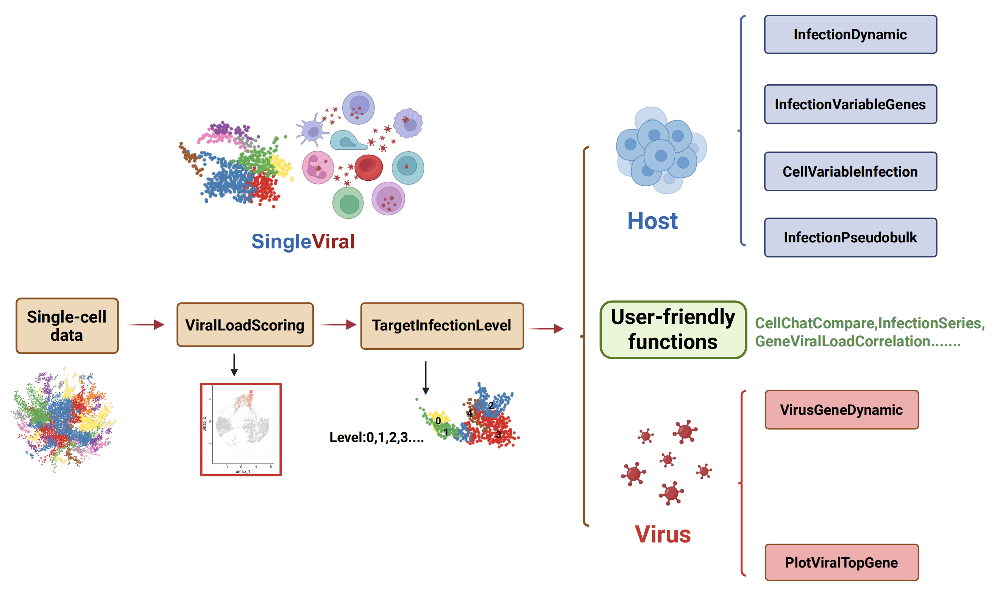

<p align="center">
  
</p>

# SingleViral
## Version 0.1.0

An integrated R toolkit for viral infection quantification, classification,
and host–virus interaction analysis at the single-cell level.

---

## 🧬 Overview

**SingleViral** provides a complete, modular workflow to measure viral load,
define infection levels, identify infection-related genes, and explore
infection-driven functional and communication changes across single cells.

<p align="center">
  
</p>

### Key features

- Viral load quantification (`ViralloadScoring`)
- Viral gene dynamics analysis (`VirusGeneDynamic`)
- Infection-level classification (`TargetInfectionLevel`)
- DEG analysis and volcano plotting (`InfectionVariableGenes`)
- GSEA-based dynamic analysis (`InfectionDynamic`)
- Group-wise infection summary (`CellVariableInfection`)
- Cell-cycle scoring by infection (`CellCycleByInfection`)
- CellChat analysis by infection (`CellChatByCellInfection`)
- Compare Cell–Cell Communication (`CellChatCompare`)
- Run TraceVirus Pipeline (`RunTraceVirus`)

---

## 🚀 Installation

You can install the latest development version directly from GitHub:

```r
install.packages("devtools")
devtools::install_github("YuZhang/SingleViral")
